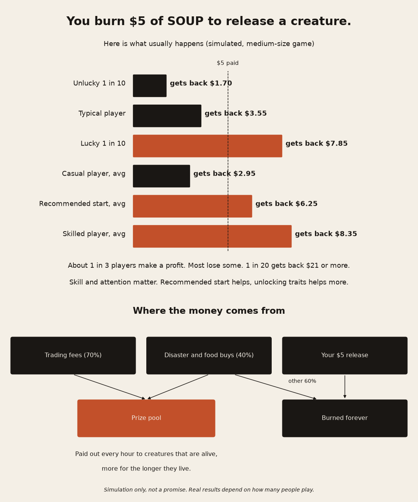

# Primordial money in one page (for beginners)

**If you burn $5 of SOUP to release a creature, here is what usually happens.** Simulated with the final rules in a medium-size game: $100k of trading per day, 200 disaster or food buys per day, and 50 releases per day.

- A typical player gets back about **$3.55**, so most players lose a little.
- Out of 10 players, the unluckiest one gets back **$1.70 or less**, and the luckiest one gets **$7.85 or more**.
- **1 in 20 gets back $21 or more.** These are lineages that keep going for a long time.
- About **1 in 3 players come out ahead**.
- Skill matters:
  - Players who drop a creature at a random spot get about **$2.95** on average.
  - Players who press **Recommended start** get about **$6.25**.
  - Skilled players who also unlock traits and watch their lineage get about **$8.35**.
- Across everyone, the game pays out about **$1.20 for every $1 burned**. The extra money comes from trading fees and disaster and food purchases.
- If far more people release than the pool can pay for, everyone gets less. The site shows yesterday's average return before you pay.

**Where the money goes:** 70% of the trading fees, plus 40% of every disaster or food purchase, go into the prize pool. The rest of those purchases, and every SOUP you burn to release, is burned forever.

**How you get paid, in one sentence:** every hour the pool pays creatures that are alive, and the longer your lineage lives the bigger your share, with some diminishing returns, so long-lived lineages win big but one colony cannot take everything.

**One free release per day** per wallet. Free creatures earn a quarter of a paid one, so you can try the game without paying.

**The price changes once a day**, so that on average players get back about 1.2 times what they burn. It is never below $1 or above $25. New creatures are protected from disasters for 10 minutes.

This is a simulation, not a promise.

## Rules a beginner could not follow, and how we simplify them

| Today | Problem | Simpler rule |
|---|---|---|
| Hourly share by population plus a 24h top-3 bonus | Two prize systems to explain | Done: the main rule is "alive creatures earn every hour". The top 3 of the day share a 15% bonus. |
| Price set from the trailing 24h pool | Nobody can predict it | Done: the site shows "Today's release price $X, yesterday avg return 1.2x", updated once a day. |
| Free releases with weights and caps | Hard to explain | "Free creature earns 1/4 of a paid one." Caps run quietly in the background. |
| Weather commit-reveal and slot hash | Too technical for players | Players just see "Cold front in 2 days". Proof stays on a separate verify page. |
| Skill tree with locks and milestones | Fine, but hides why you lose | Done: the Recommended start button marks the best vent and suggests Efficient digestion. It moves the average from 0.59x (random spot) to 1.25x. Skilled players still do better, at 1.67x. |
